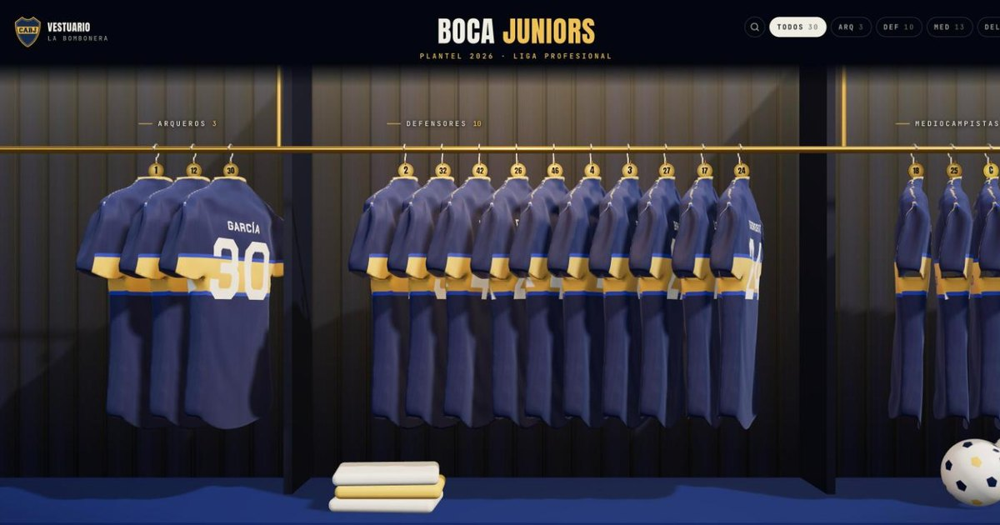
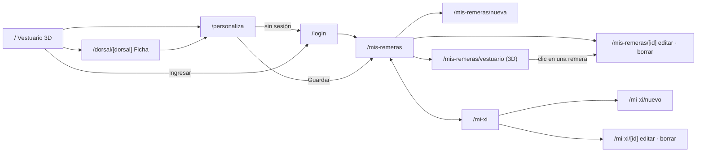
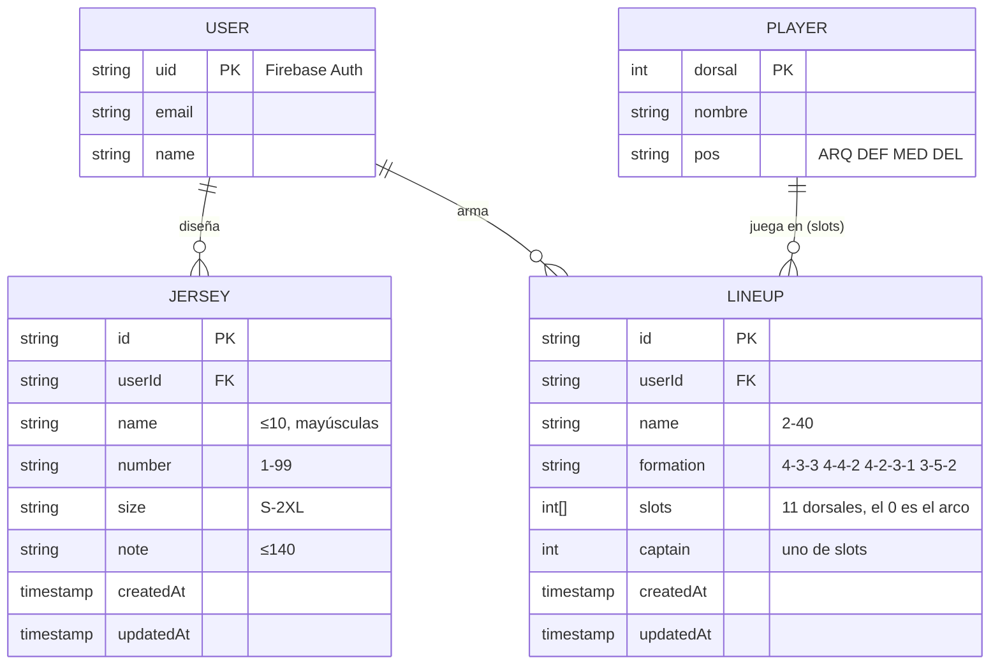

# El vestuario de Boca en 3D

> TP Final · Programación III · UMAI — Lola Amazza y Tobías Arraiza
> Next.js 16 (App Router, JavaScript) · Firebase Auth · Cloud Firestore · Three.js · Vercel
>
> **App publicada: https://boca-vestuario.vercel.app**

**Propuesta:** un vestuario 3D de Boca Juniors donde cualquier hincha recorre las camisetas del plantel 2026, y con su cuenta diseña y guarda sus propias remeras y arma su XI ideal.

Recorrés la percha del vestuario: una camiseta titular por jugador, con su ficha y sus números del Torneo Clausura 2026. Desde el personalizador estampás tu nombre y tu número en vivo sobre la remera 3D. Con tu cuenta, esas remeras quedan guardadas en **Mis remeras**, colgadas en tu propio vestuario 3D, y en **Mi XI ideal** armás formaciones con el plantel. Tributo no oficial, sin afiliación con Boca Juniors ni la AFA.



## Benchmark

| Referencia | Qué resuelve y para quién | Funcionalidades | Qué tomamos | Qué cambia en la nuestra |
| --- | --- | --- | --- | --- |
| [El vestuario del Huesca](https://sdhuesca.bellostas.studio/) (Bellostas Studio) | Experiencia para hinchas de la SD Huesca: conocer el plantel de una forma memorable | Riel 3D de camisetas, ficha por jugador, filtros, buscador, personalizador | La experiencia completa del vestuario: riel, ficha, personalizador, rutas por dorsal, intro y sonido | Llevamos la experiencia a Boca y le sumamos cuenta: lo que personalizás se guarda, se edita y se ve colgado en tu vestuario |
| [BocaShop](https://www.bocashop.com.ar/) (tienda oficial) | Comprar la camiseta oficial con estampado | Catálogo, talles, estampado de nombre y número | Las reglas de estampado (10 letras, 2 cifras) y los talles | Vista previa 3D en vivo y guardado de diseños sin comprar |
| [Futbin · Squad Builder](https://www.futbin.com/squad-builder) | Armar equipos ideales para el juego EA FC | Cancha con esquemas, un jugador por puesto, capitán | La interacción de cancha + selector por puesto | Plantel real de Boca 2026, validación de puestos (el arco solo para arqueros) y guardado por usuario |

## Funcionalidades

**Públicas**
- `/` **Landing page unificada e interactiva:**
  - **Vestuario 3D:** 30 remeras del plantel 2026 agrupadas por línea, arrastre con inercia, hover con epígrafe, filtros, buscador (`/`), teclado (← → Enter Esc) y sonido ambiente sintetizado con WebAudio.
  - **Capítulo 01 · Historia en la piel (1905–2026):** recorrido horizontal tipo collage editorial con las 17 camisetas históricas y fotografías reales de archivo.
  - **Capítulo 02 · Vitrina de trofeos 3D:** las 51 copas modeladas por código con sus materiales y siluetas reales (Libertadores en plata con pedestal de caoba, chapitas de campeones y futbolista en la cima; Intercontinental en oro; Sudamericana en plata con anillo inclinado; Copa Argentina facetada; Primera División), pre-compilada para carga instantánea.
  - **Capítulo 03 · Salón de ídolos:** selector interactivo y recorrido por las 10 máximas leyendas del club.
  - **Capítulo 04 · La Bombonera 3D:** maqueta 3D interactiva del Estadio Alberto J. Armando con vista aérea, vuelo a cinco ubicaciones de tribuna, sonido de hinchada y plano alternativo sin WebGL.
  - **Capítulo 05 · Tu carnet xeneize:** editor en vivo de carnet de hincha con trama Guilloché, giro frente/dorso, foto local opcional y descarga en PNG.
  - **Capítulo 06 · Trivia xeneize:** juego de 10 preguntas con temporizador de 20 segundos, corrección en servidor y tabla de posiciones.
- `/cronologia` El riel 3D del vestuario con diez camisetas históricas en orden cronológico. Arrastrá para recorrer las perchas y abrí una ficha para girar la camiseta. Los años se pueden compartir por enlace y cada ficha conserva la foto de archivo.
- `/museo` Archivo documental completo de camisetas históricas con sus fuentes.
- `/dorsal/[dorsal]` Ficha del jugador con la remera en primer plano (se gira arrastrando), retrato, estadísticas y datos. Metadata propia por jugador.
- `/personaliza` Personalizador: nombre, número y talle estampados en vivo; **Guardar en Mis remeras** (pide ingresar si no hay sesión y vuelve con el diseño).
- `/bombonera` Vista dedicada de la maqueta 3D del estadio.
- `/idolos` Vista dedicada del Salón de ídolos y fichas individuales en `/idolos/[slug]`.
- `/trivia` Vista dedicada de la trivia y `/trivia/ranking` con el ranking público.
- `/carnet` Vista dedicada del editor de carnet virtual.

**Privadas** (requieren cuenta)
- `/mis-remeras` ABM de remeras personalizadas: listado con vista previa, `/mis-remeras/nueva`, `/mis-remeras/[id]` (editar y borrar), `/mis-remeras/vestuario` (tus remeras colgadas en el riel 3D).
- `/mi-xi` ABM de formaciones: listado con cancha, `/mi-xi/nuevo`, `/mi-xi/[id]`.
- `/mi-carnet` Carnet guardado de cada usuario, con edición y baja.
- `/trivia/mis-partidas` Partidas propias, con resumen, enlace para compartir ronda y baja.
- `/login` Email y contraseña, o Google.

## Mapa de navegación

El botón **Menú** abre la navegación principal en las cabeceras. Reúne el vestuario, la cronología, el museo, los ídolos, la Bombonera, la trivia, el carnet, el personalizador y las secciones de cuenta. Además, la landing page (`/`) integra una barra fija de capítulos (`01 Historia` · `02 Vitrina` · `03 Ídolos` · `04 Bombonera` · `05 Carnet` · `06 Trivia`) para recorrer toda la experiencia sin salir de la portada. La página actual queda marcada y se puede recorrer con Tab y cerrar con Escape o clic afuera.



## Modelo de datos

Firestore, dos colecciones. Cada documento guarda el `userId` del dueño.



`PLAYER` no está en Firestore: es el plantel (`src/data/squad.json`), generado de Transfermarkt con `scripts/fetch_squad.py`.

## Tecnologías y decisiones

| Qué | Por qué |
| --- | --- |
| **Next.js 16 App Router** en JavaScript | Lo pide la cátedra. Rutas públicas renderizadas en el servidor con metadata por página; privadas protegidas en servidor. |
| **Firebase Auth** + cookie de sesión HTTP-only | El login pasa por el SDK cliente y se cambia por una cookie que el servidor verifica con Firebase Admin (`/api/session/login`). El servidor nunca confía en un uid del cliente. |
| **Cloud Firestore vía Admin SDK** | Todas las lecturas y escrituras van por Server Components y **Server Actions**; `ownedCollection.js` compara el `userId` en cada operación. Las reglas cierran el acceso directo desde el navegador. |
| **Three.js + React Three Fiber** | La escena 3D. El riel es una clase imperativa (`RailRig`) porque anima 30 remeras por frame sin pasar por React; React maneja la UI alrededor. |
| **GSAP** | Intro de cámara, telón, aparición de la ficha, cinta corrida. |
| **Tailwind CSS v4** | Tokens de diseño en `@theme` (`globals.css`). |
| **zustand** | Estado del vestuario que la escena lee 60 veces por segundo fuera de React (`getState()`); con Context cada cambio re-renderizaría el árbol. |
| **Context API** | Usuario activo (`SessionContext`): lo resuelve el layout raíz en el servidor y lo usan cabecera, personalizador y login. |
| **Vitest** | 406 tests de lógica (riel, validaciones, rutas, geometría, trivia y carnet) en el pre-commit. |

**Server vs Client Components:** las páginas y layouts son Server Components (leen la sesión y Firestore). Son Client Components solo los que necesitan navegador: el vestuario 3D (cargado con `next/dynamic` sin SSR, porque WebGL no existe en el servidor), los formularios (estado, `useActionState`), el login (SDK de Firebase) y los que leen el Context de sesión.

**Remera 3D:** el modelo es un GLB (remera + percha + gancho) en `public/models/camiseta.glb`. La textura no es una foto: se pinta en un canvas sobre el layout UV del modelo (franja, cuello, logos oficiales en SVG, nombre y número), así cada jugador y cada diseño propio tienen su propia remera nítida. Si el GLB no está, se usa una remera equivalente generada por código. Ver [docs/MODELO-3D.md](docs/MODELO-3D.md).

## Requisitos de la consigna

| Requisito | Dónde |
| --- | --- |
| ABM de entidad principal | Mis remeras (`src/app/(cuenta)/mis-remeras`), y además Mi XI |
| Rutas públicas y privadas | `(vestuario)` y `login` públicas; `(cuenta)` privada |
| Protección de rutas | `src/proxy.js` (sin cookie → login) + `requireUser()` en layout y en cada Server Action |
| Datos por usuario y aislamiento | `src/lib/data/ownedCollection.js` + `firestore.rules`; probado en `npm run smoke` |
| Ruta dinámica | `/dorsal/[dorsal]`, `/mis-remeras/[id]`, `/mi-xi/[id]` |
| Server Actions | `mis-remeras/actions.js`, `mi-xi/actions.js` |
| Formularios con validación | `JerseyForm`, `LineupForm`, `LoginForm`; reglas en `src/lib/domain` compartidas cliente/servidor |
| Carga, error, vacío | `loading.js`, `error.js`, `not-found.js` (raíz y por sección) y estados vacíos en cada listado |
| Metadata por página | `generateMetadata` en fichas, remeras y XI; `metadata` en el resto |
| Context API | `src/context/SessionContext.js` |

## Opcionales implementados

1. **Escena 3D integrada al producto:** vestuario público y vestuario personal con las remeras del usuario.
2. **Búsqueda y filtros:** buscador por nombre o dorsal y filtros por línea.
3. **SEO:** Open Graph, `sitemap.xml`, `robots.txt` y metadata dinámica por jugador.
4. **Accesibilidad:** navegación por teclado, textos alternativos, errores de formulario asociados al campo, versión en lista para lectores de pantalla y sin WebGL, `prefers-reduced-motion`.

## Instalación

```bash
npm install
cp .env.example .env.local      # completar (ver abajo)
npm run dev                     # http://localhost:4950
```

**Variables de entorno** (`.env.example` documentado):
- `NEXT_PUBLIC_FIREBASE_*`: configuración web de Firebase (públicas).
- `FIREBASE_PROJECT_ID`, `FIREBASE_CLIENT_EMAIL`, `FIREBASE_PRIVATE_KEY`: cuenta de servicio (secretas). Se cargan desde el JSON de la consola con `node scripts/env-from-service-account.mjs ~/Downloads/<clave>.json`.
- `NEXT_PUBLIC_SITE_URL`: URL pública (metadata y sitemap).

**Firebase:** proyecto `boca-vestuario-tp`, con Authentication (Email/Password y Google) y Firestore. Reglas: `firebase deploy --only firestore:rules`.

| Comando | Qué hace |
| --- | --- |
| `npm run gate` | tests + lint + build |
| `npx next build --webpack` | compilación alternativa cuando el entorno restringe los puertos internos de Turbopack |
| `npm test` | tests de lógica pura (< 1 s, también en el pre-commit) |
| `npm run smoke` | ABM completo contra Firestore real, incluida la prueba de que un usuario no accede a datos de otro |
| `npm run seed` | crea el usuario de prueba con datos de ejemplo |
| `npm run eval` | compara el plantel publicado con Transfermarkt en vivo |
| `npm run data` | regenera plantel, estadísticas y retratos |

## Deploy

Vercel, proyecto `boca-vestuario`, funciones en `gru1` (São Paulo, junto a Firestore). Las variables de `.env.local` están cargadas en el entorno de producción y `boca-vestuario.vercel.app` está en los dominios autorizados de Firebase Auth.

```bash
vercel deploy --prod
```

Dos detalles que hacen falta para que Firebase Admin cargue en Vercel:
- `engines.node: 24.x` en `package.json`.
- `overrides: { "jwks-rsa": "3.2.2" }`: la 4.x pide `jose` 6 (solo ESM) con `require()`, y el runtime de Vercel no permite `require()` de módulos ESM (`ERR_REQUIRE_ESM`). La 3.2.2 usa `jose` 4, que trae CommonJS, y `firebase-admin` la usa con la misma API.

## Usuario de prueba

| Email | Contraseña |
| --- | --- |
| `prueba@vestuario-boca.test` | `DaleBoca2026` |

Tiene 3 remeras y 1 XI cargados (`npm run seed`).

## Estructura

```
src/
  app/
    (vestuario)/        rutas públicas que comparten el canvas 3D: /, /dorsal/[dorsal], /personaliza
    (cuenta)/           rutas privadas: mis-remeras, mi-xi (+ actions.js con Server Actions)
    login/  api/session/  layout.js  error.js  not-found.js  sitemap.js  robots.js
  proxy.js              protección de rutas privadas
  containers/           vestuario, cabecera y ficha conectados al estado
  components/           three/, card/, layout/, overlay/, search/, ui/, account/, jerseys/, lineups/
  context/              SessionContext (usuario activo)
  lib/
    firebase/           admin, cliente, sesión (boilerplate de la cátedra)
    data/               acceso a Firestore por dueño (jerseys, lineups)
    domain/             validaciones puras compartidas cliente/servidor
  engine/               lógica pura del riel, rutas, texto (con tests)
  three/                escena: RailRig, Jersey, vestuario, textura de la remera, modelo
  store/  hooks/  config/site.js  data/ (plantel)
scripts/                datos de Transfermarkt, seed, smoke, drift, clave de servicio
```

## Datos y assets

- Plantel y estadísticas: Transfermarkt (Torneo Clausura 2026). Los arqueros muestran "Convocado" porque los goles en contra no están disponibles en HTML.
- Escudo y logos: SVG del sitio oficial del club. Retratos: Transfermarkt. Tributo no oficial.
- Modelo 3D de la remera y diseño de la experiencia: basados en [sdhuesca.bellostas.studio](https://sdhuesca.bellostas.studio/) (Bellostas Studio), con crédito en el pie del sitio.
- Tipografías vía Fontsource (OFL). Nombre y número en Chakra Petch (provisoria).

## Declaración de uso de Inteligencia Artificial (IA)

### 1. Consentimiento y herramientas utilizadas
Durante el desarrollo de este Trabajo Práctico Final utilizamos herramientas de Inteligencia Artificial generativa —**Claude Code (Anthropic)** y **Antigravity (Google DeepMind)**— como asistentes de programación, pair-programming y consulta técnica. Todo el código generado o refactorizado con asistencia de IA fue revisado, probado, ajustado y validado por nosotros (**Lola Amazza** y **Tobías Arraiza**), quienes comprendemos su funcionamiento de punta a punta para su defensa oral y técnica.

### 2. ¿En qué partes del proyecto se utilizó la IA?
* **Modelado 3D procedural y motor gráfico (Three.js + React Three Fiber):**
  * Asistencia en la matemática del riel 3D (`RailRig`), cálculo de inercia, empuje entre perchas vecinas y péndulo amortiguado de las camisetas (`swing.js`).
  * Generación procedural por código de los **modelos 3D reales de las 51 copas** de la Vitrina (`src/three/trophies/`) mediante perfiles de revolución (`LatheGeometry`), splines cúbicas monótonas, asas toroidales, pedestales con chapitas de campeones e `InstancedMesh` para dibujar todas las copas con mínimas llamadas de dibujo (*draw calls*).
  * Pintura dinámica en `<canvas>` 2D sobre el mapa UV del modelo GLB (`paintKit.js`) para estampar escudos, patrocinadores, nombres y dorsales en tiempo real.
* **Arquitectura Full-Stack en Next.js 16 (App Router) y Firebase:**
  * Estructuración de **Server Components** y **Server Actions** para los ABM de *Mis remeras*, *Mi XI ideal*, *Mi carnet* y *Trivia xeneize*.
  * Implementación del flujo de autenticación seguro: intercambio del token de Firebase Auth cliente por una cookie de sesión `HTTP-only` verificada en servidor con `firebase-admin`, protección en `proxy.js` y aislamiento por `userId` en `ownedCollection.js`.
* **Automatización de datos y suite de tests:**
  * Creación de scripts en Python (`scripts/fetch_squad.py`, `scripts/fetch_historia.py`) para relevar de forma determinística el plantel 2026 desde Transfermarkt y las fotografías libres desde Wikimedia Commons.
  * Redacción de **398 tests unitarios en Vitest** que verifican invariantes geométricas de los modelos 3D, validaciones compartidas cliente/servidor, armado del banco de preguntas de la trivia y generación del carnet.

### 3. Intervención humana, criterio propio y correcciones sobre la IA
La IA no tomó las decisiones de producto ni produjo resultados finales sin iteración; nuestra intervención fue determinante en:
* **Dirección estética, curaduría e integración en una sola Landing Page:**
  * Definimos la identidad visual xeneize (estética de afiche editorial oscuro `#05080f`, tramas de imprenta, tipografías *Anton*, *Instrument Serif* y *JetBrains Mono* con acentos en oro `#f0c057`) y decidimos unificar toda la experiencia (Vestuario 3D → Historia en la piel → Vitrina 3D → Salón de Ídolos → La Bombonera 3D → Carnet Virtual → Trivia) en un recorrido continuo y coherente.
* **Optimización de rendimiento en el scroll horizontal y WebGL:**
  * *Qué hubo que corregir:* la primera versión del recorrido horizontal de *Historia en la piel* sufría caídas de frames porque combinaba filtros SVG `<feTurbulence>` sobre un contenedor móvil de 15.000 px de ancho con `filter: drop-shadow(...)`, `mix-blend-mode` y animaciones de `clip-path` en cada tarjeta, además de cargar tardíamente la Vitrina 3D con `next/dynamic`.
  * *Cómo lo resolvimos:* fijamos el fondo `.paper-grunge` al contenedor `sticky` del viewport (`100vw × 100dvh`), reemplazamos las animaciones de `clip-path` y `mix-blend-mode` por transformaciones aceleradas por GPU (`transform + opacity`), pre-decodificamos las imágenes (`loading="eager" decoding="async"`) y pre-compilamos los shaders WebGL de la Vitrina en segundo plano (`gl.compile`) con `frameloop="never"` mientras está fuera de vista.
* **Fidelidad de los modelos y experiencia de usuario:**
  * *Qué hubo que corregir:* inicialmente las copas de la Vitrina eran siluetas genéricas todas del mismo color dorado, y una iteración intermedia de efectos de sonido resultaba invasiva. Revertimos los cambios sonoros que no sumaban a la experiencia y rediseñamos los modelos 3D de las copas para que respeten las copas reales que ganó Boca (la Copa Libertadores en plata sobre su pedestal alto de caoba con las filas de chapitas metálicas y el jugador pateando en la cima, la Sudamericana en plata con su globo y anillo inclinado, la Intercontinental en oro, la Copa Argentina facetada y los trofeos de Primera División).
* **Resolución de incompatibilidades en producción (Vercel + Node 24):**
  * Diagnosticamos y resolvimos el fallo `ERR_REQUIRE_ESM` de `firebase-admin` en el runtime serverless de Vercel fijando el override de `jwks-rsa@3.2.2` en `package.json`.

### 4. Aprendizajes y reflexión
1. **Separación entre estado reactivo y bucle de animación 3D:** Aprendimos por qué animar 30 camisetas en 3D a 60/120fps dentro del ciclo de re-render de React degrada el rendimiento, y cómo resolverlo leyendo un store liviano (`zustand.getState()`) y un bus de eventos por cuadro (`frameBus`) desde una clase imperativa (`RailRig`), dejando a React exclusivamente la interfaz superpuesta.
2. **Seguridad y validación isomórfica en Next.js App Router:** Comprendimos la importancia de no confiar nunca en parámetros enviados desde el cliente en las Server Actions: el `uid` se obtiene exclusivamente verificando la cookie de sesión en el servidor, y las funciones de validación puras en `src/lib/domain/` garantizan las mismas reglas en la vista previa instantánea y en la escritura en Firestore.
3. **Rol de la IA en el desarrollo de software:** La IA demostró ser un multiplicador enorme para prototipar geometría matemática, shaders y tests exhaustivos, pero aprendimos que **sin criterio humano de arquitectura, perfilado de rendimiento en el navegador y dirección de diseño**, el código generado puede acumular sobrecarga visual o cuellos de botella de GPU. Auditar cada cambio, medir y saber cuándo descartar o reescribir una propuesta de la IA fue clave para lograr un producto fluido y sólido.


## Verificar la cronología en Chrome

Con `npm run dev` en marcha, abrí Chrome con un perfil temporal, `--remote-debugging-port=9229` y, para ejecución sin GPU, `--headless --enable-unsafe-swiftshader --use-angle=swiftshader`. Ejecutá `node scripts/eval-cronologia.mjs`. La evaluación recorre el riel por arrastre, abre las diez fichas, verifica el giro y los enlaces por año, prueba un ancho de 390 px y carga la foto de archivo al perder WebGL. Los detalles de los diseños se toman del archivo oficial de Boca y de la ficha adidas JJ4286 para el modelo de 2025. Los recortes de estampados reutilizan las fotos de public/museo en tiempo de carga. Podés definir `CRONOLOGIA_URL` o `CHROME_DEVTOOLS_URL` para usar otros puertos.

Para probar el menú con la misma sesión de Chrome, ejecutá `node scripts/eval-navbar.mjs`. Verifica teclado, cierre, navegación pública, entrada al área privada y el ancho de 320 px. Podés definir `NAVBAR_URL` para apuntar a otro puerto.
