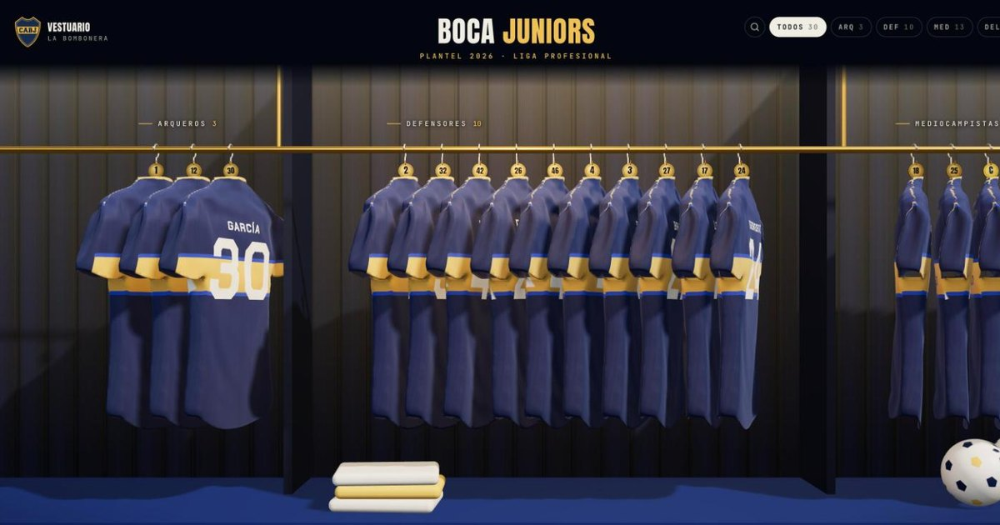
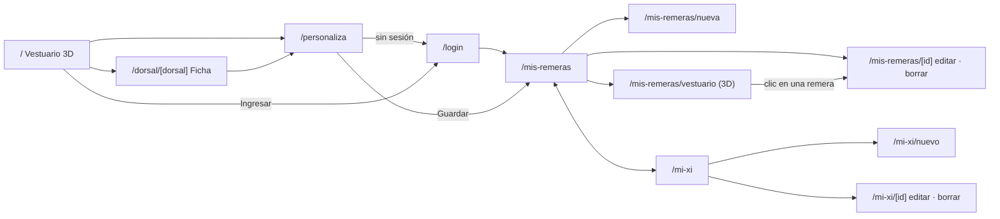
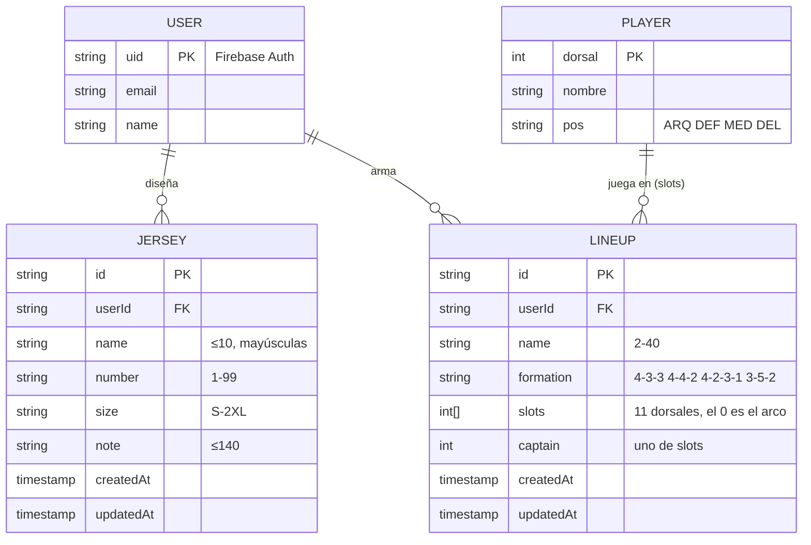

# El vestuario de Boca en 3D

> TP Final · Programación III · UMAI — Lola Amazza y Tobías Arraiza
> Next.js 16 (App Router, JavaScript) · Firebase Auth · Cloud Firestore · Three.js · Vercel

**Propuesta:** un vestuario 3D de Boca Juniors donde cualquier hincha recorre las camisetas del plantel 2026, y con su cuenta diseña y guarda sus propias remeras y arma su XI ideal.

Recorrés la percha del vestuario: una camiseta titular por jugador, con su ficha y sus números del Torneo Clausura 2026. Desde el personalizador estampás tu nombre y tu número en vivo sobre la remera 3D. Con tu cuenta, esas remeras quedan guardadas en **Mis remeras**, colgadas en tu propio vestuario 3D, y en **Mi XI ideal** armás formaciones con el plantel. Tributo no oficial, sin afiliación con Boca Juniors ni la AFA.



## Benchmark

| Referencia | Qué resuelve y para quién | Funcionalidades | Qué tomamos | Qué cambia en la nuestra |
| --- | --- | --- | --- | --- |
| [El vestuario del Huesca](https://sdhuesca.bellostas.studio/) (Bellostas Studio) | Experiencia para hinchas de la SD Huesca: conocer el plantel de una forma memorable | Riel 3D de camisetas, ficha por jugador, filtros, buscador, personalizador | La experiencia completa del vestuario: riel, ficha, personalizador, rutas por dorsal, intro y sonido | Llevamos la experiencia a Boca y le sumamos cuenta: lo que personalizás se guarda, se edita y se ve colgado en tu vestuario |
| [BocaShop](https://www.bocashop.com.ar/) (tienda oficial) | Comprar la camiseta oficial con estampado | Catálogo, talles, estampado de nombre y número | Las reglas de estampado (10 letras, 2 cifras) y los talles | Vista previa 3D en vivo y guardado de diseños sin comprar |
| [Futbin · Squad Builder](https://www.futbin.com/squad-builder) | Armar equipos ideales para el juego EA FC | Cancha con esquemas, un jugador por puesto, capitán | La interacción de cancha + selector por puesto | Plantel real de Boca 2026, validación de puestos (el arco solo para arqueros) y guardado por usuario |

## Funcionalidades

**Públicas**
- `/` Vestuario 3D: 30 remeras agrupadas por línea, arrastre con inercia, hover con epígrafe, filtros, buscador (`/`), teclado (← → Enter Esc), sonido ambiente sintetizado.
- `/dorsal/[dorsal]` Ficha del jugador con la remera en primer plano (se gira arrastrando), retrato, estadísticas y datos. Metadata propia por jugador.
- `/personaliza` Personalizador: nombre, número y talle estampados en vivo; **Guardar en Mis remeras** (pide ingresar si no hay sesión y vuelve con el diseño).

**Privadas** (requieren cuenta)
- `/mis-remeras` ABM de remeras personalizadas: listado con vista previa, `/mis-remeras/nueva`, `/mis-remeras/[id]` (editar y borrar), `/mis-remeras/vestuario` (tus remeras colgadas en el riel 3D).
- `/mi-xi` ABM de formaciones: listado con cancha, `/mi-xi/nuevo`, `/mi-xi/[id]`.
- `/login` Email y contraseña, o Google.

## Mapa de navegación



## Modelo de datos

Firestore, dos colecciones. Cada documento guarda el `userId` del dueño.



`PLAYER` no está en Firestore: es el plantel (`src/data/squad.json`), generado de Transfermarkt con `scripts/fetch_squad.py`.

## Tecnologías y decisiones

| Qué | Por qué |
| --- | --- |
| **Next.js 16 App Router** en JavaScript | Lo pide la cátedra. Rutas públicas renderizadas en el servidor con metadata por página; privadas protegidas en servidor. |
| **Firebase Auth** + cookie de sesión HTTP-only | El login pasa por el SDK cliente y se cambia por una cookie que el servidor verifica con Firebase Admin (`/api/session/login`). El servidor nunca confía en un uid del cliente. |
| **Cloud Firestore vía Admin SDK** | Todas las lecturas y escrituras van por Server Components y **Server Actions**; `ownedCollection.js` compara el `userId` en cada operación. Las reglas cierran el acceso directo desde el navegador. |
| **Three.js + React Three Fiber** | La escena 3D. El riel es una clase imperativa (`RailRig`) porque anima 30 remeras por frame sin pasar por React; React maneja la UI alrededor. |
| **GSAP** | Intro de cámara, telón, aparición de la ficha, cinta corrida. |
| **Tailwind CSS v4** | Tokens de diseño en `@theme` (`globals.css`). |
| **zustand** | Estado del vestuario que la escena lee 60 veces por segundo fuera de React (`getState()`); con Context cada cambio re-renderizaría el árbol. |
| **Context API** | Usuario activo (`SessionContext`): lo resuelve el layout raíz en el servidor y lo usan cabecera, personalizador y login. |
| **Vitest** | 68 tests de lógica pura (riel, validaciones, rutas, geometría) en el pre-commit. |

**Server vs Client Components:** las páginas y layouts son Server Components (leen la sesión y Firestore). Son Client Components solo los que necesitan navegador: el vestuario 3D (cargado con `next/dynamic` sin SSR, porque WebGL no existe en el servidor), los formularios (estado, `useActionState`), el login (SDK de Firebase) y los que leen el Context de sesión.

**Remera 3D:** el modelo es un GLB (remera + percha + gancho) en `public/models/camiseta.glb`. La textura no es una foto: se pinta en un canvas sobre el layout UV del modelo (franja, cuello, logos oficiales en SVG, nombre y número), así cada jugador y cada diseño propio tienen su propia remera nítida. Si el GLB no está, se usa una remera equivalente generada por código. Ver [docs/MODELO-3D.md](docs/MODELO-3D.md).

## Requisitos de la consigna

| Requisito | Dónde |
| --- | --- |
| ABM de entidad principal | Mis remeras (`src/app/(cuenta)/mis-remeras`), y además Mi XI |
| Rutas públicas y privadas | `(vestuario)` y `login` públicas; `(cuenta)` privada |
| Protección de rutas | `src/proxy.js` (sin cookie → login) + `requireUser()` en layout y en cada Server Action |
| Datos por usuario y aislamiento | `src/lib/data/ownedCollection.js` + `firestore.rules`; probado en `npm run smoke` |
| Ruta dinámica | `/dorsal/[dorsal]`, `/mis-remeras/[id]`, `/mi-xi/[id]` |
| Server Actions | `mis-remeras/actions.js`, `mi-xi/actions.js` |
| Formularios con validación | `JerseyForm`, `LineupForm`, `LoginForm`; reglas en `src/lib/domain` compartidas cliente/servidor |
| Carga, error, vacío | `loading.js`, `error.js`, `not-found.js` (raíz y por sección) y estados vacíos en cada listado |
| Metadata por página | `generateMetadata` en fichas, remeras y XI; `metadata` en el resto |
| Context API | `src/context/SessionContext.js` |

## Opcionales implementados

1. **Escena 3D integrada al producto:** vestuario público y vestuario personal con las remeras del usuario.
2. **Búsqueda y filtros:** buscador por nombre o dorsal y filtros por línea.
3. **SEO:** Open Graph, `sitemap.xml`, `robots.txt` y metadata dinámica por jugador.
4. **Accesibilidad:** navegación por teclado, textos alternativos, errores de formulario asociados al campo, versión en lista para lectores de pantalla y sin WebGL, `prefers-reduced-motion`.

## Instalación

```bash
npm install
cp .env.example .env.local      # completar (ver abajo)
npm run dev                     # http://localhost:4950
```

**Variables de entorno** (`.env.example` documentado):
- `NEXT_PUBLIC_FIREBASE_*`: configuración web de Firebase (públicas).
- `FIREBASE_PROJECT_ID`, `FIREBASE_CLIENT_EMAIL`, `FIREBASE_PRIVATE_KEY`: cuenta de servicio (secretas). Se cargan desde el JSON de la consola con `node scripts/env-from-service-account.mjs ~/Downloads/<clave>.json`.
- `NEXT_PUBLIC_SITE_URL`: URL pública (metadata y sitemap).

**Firebase:** proyecto `boca-vestuario-tp`, con Authentication (Email/Password y Google) y Firestore. Reglas: `firebase deploy --only firestore:rules`.

| Comando | Qué hace |
| --- | --- |
| `npm run gate` | tests + lint + build |
| `npm test` | tests de lógica pura (< 1 s, también en el pre-commit) |
| `npm run smoke` | ABM completo contra Firestore real, incluida la prueba de que un usuario no accede a datos de otro |
| `npm run seed` | crea el usuario de prueba con datos de ejemplo |
| `npm run eval` | compara el plantel publicado con Transfermarkt en vivo |
| `npm run data` | regenera plantel, estadísticas y retratos |

## Usuario de prueba

| Email | Contraseña |
| --- | --- |
| `prueba@vestuario-boca.test` | `DaleBoca2026` |

Tiene 3 remeras y 1 XI cargados (`npm run seed`).

## Estructura

```
src/
  app/
    (vestuario)/        rutas públicas que comparten el canvas 3D: /, /dorsal/[dorsal], /personaliza
    (cuenta)/           rutas privadas: mis-remeras, mi-xi (+ actions.js con Server Actions)
    login/  api/session/  layout.js  error.js  not-found.js  sitemap.js  robots.js
  proxy.js              protección de rutas privadas
  containers/           vestuario, cabecera y ficha conectados al estado
  components/           three/, card/, layout/, overlay/, search/, ui/, account/, jerseys/, lineups/
  context/              SessionContext (usuario activo)
  lib/
    firebase/           admin, cliente, sesión (boilerplate de la cátedra)
    data/               acceso a Firestore por dueño (jerseys, lineups)
    domain/             validaciones puras compartidas cliente/servidor
  engine/               lógica pura del riel, rutas, texto (con tests)
  three/                escena: RailRig, Jersey, vestuario, textura de la remera, modelo
  store/  hooks/  config/site.js  data/ (plantel)
scripts/                datos de Transfermarkt, seed, smoke, drift, clave de servicio
```

## Datos y assets

- Plantel y estadísticas: Transfermarkt (Torneo Clausura 2026). Los arqueros muestran "Convocado" porque los goles en contra no están disponibles en HTML.
- Escudo y logos: SVG del sitio oficial del club. Retratos: Transfermarkt. Tributo no oficial.
- Modelo 3D de la remera y diseño de la experiencia: basados en [sdhuesca.bellostas.studio](https://sdhuesca.bellostas.studio/) (Bellostas Studio), con crédito en el pie del sitio.
- Tipografías vía Fontsource (OFL). Nombre y número en Chakra Petch (provisoria).

## Uso de IA

**Consentimiento.** Usamos Claude Code (Anthropic) como asistente de programación en este proyecto: análisis del sitio de referencia, scripts de datos, textura procedural de la remera, motor del riel 3D, migración de Vite a Next.js, autenticación, ABM, tests y esta documentación. Todo el código pasó por nuestra revisión y podemos explicarlo en la defensa.

**Reflexión.** _(Para completar por Lola y Tobías antes de la entrega: qué aportó la IA, qué hubo que corregir y qué aprendieron.)_
